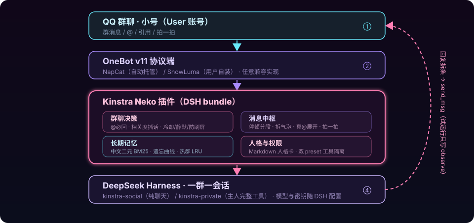

<h3 align="center">住在你 QQ 群里的猫娘</h3>

<p align="center">
一个自部署的社交陪伴机器人 —— 被 @ 会回，没人叫时按话题相关度自然插话，记得群友的小事，有自己的性格。
<br/>
基于 <a href="https://github.com/deepseek-ai/deepseek-harness">DeepSeek Harness</a> 二次开发，通过 OneBot v11 接入 QQ。
</p>

<div align="center">


</div>

> [!WARNING]
> **账号风险须知**：QQ 非官方协议接入存在账号被限制的可能。**请务必使用专门注册的小号**，本项目作者不对任何账号后果负责。建议先拉小号进测试群体验，确认稳定再长期使用。

---

## 特性

<table>
<tr>
<td width="50%" valign="top">
<h4>💬 低打扰的群聊存在感</h4>
被 @、被引用、叫名字必回；没被叫到时，只在话题真的和她有关、群里正热闹、过了冷却期时以小概率插话；加入话题后顺着聊几句，话题走远就安静。冷却、每小时上限、静默时段、防刷屏全部可配。
</td>
<td width="50%" valign="top">
<h4>🔒 出厂即安全默认</h4>
总开关关、试运行（observe）开、白名单空 —— 不配置一句话都不会发。试运行期间她只在面板记录「我本来会说什么」，确认对味再开麦。主人私聊永远放行，陌生人会话零本地工具。
</td>
</tr>
<tr>
<td width="50%" valign="top">
<h4>🧠 零依赖长期记忆</h4>
自带中文二元切词 BM25 记忆库：JSONL 磁盘事实库 + 热群 LRU 内存倒排索引（冷群零驻留）+ 遗忘曲线与人物档案。无需 Redis / 数据库，2G 内存服务器也跑得动。
</td>
<td width="50%" valign="top">
<h4>🐾 可微调的原创人格</h4>
面板直接编辑 Markdown 人格卡，下一轮即时生效；系统提示词变量、记忆上下文、remember / recall 工具自动挂载。回复支持换行多气泡、引用、真 @ 群成员、拍一拍，带拟人打字延迟。
</td>
</tr>
<tr>
<td width="50%" valign="top">
<h4>🖥️ 图形化首启向导</h4>
浏览器内三步向导 + 七个配置页面（概览 / 连接 / 群聊与权限 / 人格 / 试运行 / 日志 / 高级），品牌化界面，零 UI 库依赖。主人还能直接在 DSH 面板里翻看每个群的长会话、随时插话。
</td>
<td width="50%" valign="top">
<h4>📦 一条命令装完，无 Docker</h4>
Linux 一键脚本：Node 22、内存不足自动加 2G swap、NapCat 自动托管、systemd 守护（开机自启、崩溃重启、700MB 内存上限）；Windows 引导脚本 + 桌面快捷方式。用户只需扫码登录小号、粘贴模型 API Key。
</td>
</tr>
</table>

### 它有意不做

- **不内置 TTS 语音、翻唱、视频等重模块** —— 保持 2G 可跑、行为可预期；后续作为可选模块提供。
- **不打包、不自动下载 SnowLuma** —— 其 EULA 要求用户自行安装并同意条款；插件只在你装好后接管，并只注入核对过的机器人小号。
- **不 fork DSH 内核** —— 本项目是一个 DSH bundle 插件，内核随 npm 官方源独立更新。

---

## 快速开始

### 🐧 Linux 云服务器（Ubuntu / Debian，2H2G 友好）

```bash
curl -fsSL https://raw.githubusercontent.com/EROQIN/kinstra-neko/main/installer/linux/install.sh | sudo bash
# 国内网络慢可： sudo CN_MIRROR=1 bash install.sh
```

脚本会：装 Node 22（内存不足自动加 2G swap，swappiness=10）→ 全局装 DSH → 建独立 `kinstra-neko` profile 并装本插件 → 引导装 NapCat（无桌面环境配 Xvfb 扫码）→ 注册 `kinstra-neko` systemd 服务（开机自启、`--max-old-space-size=700`）。

### 🪟 Windows

```powershell
irm https://raw.githubusercontent.com/EROQIN/kinstra-neko/main/installer/windows/install.ps1 | iex
```

Windows 推荐 [SnowLuma](https://github.com/SnowLuma/SnowLuma/releases/latest)（自行下载、本人同意条款后，面板里自动启停与接入小号），同样支持 NapCat 与任意 OneBot v11 实现。

### 🧑‍💻 已有 Node 环境，只想装插件

```bash
npx kinstra-neko@latest init          # 建 profile、装 bundle、引导写凭据
dsh --profile kinstra-neko web --port 3090
```

### 装完之后 · 3 分钟向导

1. 浏览器打开 `http://127.0.0.1:3090`（云服务器用 `http://<IP>:3090`，注意安全组放行）。
2. 按向导填：**猫娘小号 QQ**、**你的 QQ（主人）**。
3. 在 NapCat / SnowLuma 用小号扫码登录；连接页核对登录号与配置一致。
4. 在 DSH 设置里配置模型服务商与 API Key（DeepSeek 官方或任意 OpenAI 兼容端点）。
5. 在「群聊与权限」里加白名单群。
6. **保持试运行**，在群里 @ 她，到面板「试运行」页看她本来会说什么；确认对味，再关试运行开麦。

---

## 模型配置

DSH 支持 DeepSeek 官方与任意 OpenAI 兼容网关。密钥写 `~/.dsh/.credentials.yaml`（权限 0600，永不明文回传面板），provider / 模型表写 profile 的 cordis 配置（DSH 设置页图形化完成，安装器也会引导）。

最小 OpenAI 兼容配置示例（`dsh-llm-pi-ai` 风格）：

```yaml
- name: '@deepseek-ai/dsh-llm-pi-ai'
  config:
    providers:
      deepseek:
        api: openai-completions
        baseURL: https://api.deepseek.com/v1
        apiKeyEnv: DEEPSEEK_API_KEY
        models:
          - id: deepseek-chat
            contextWindow: 131072
```

2G 服务器建议选上下文适中、单价低的对话模型；群会话 preset 已把 compaction 阈值调小（6144 字符触发、工具结果裁剪），控制长会话内存。

---

## 架构



```
QQ 小号
  ▲  OneBot v11（NapCat / SnowLuma / 任意实现；WS 收事件 + HTTP 调接口）
src/onebot, src/gateway
  ▼
chat hub（白名单 → 群聊决策 → 停顿分段 → 引用/@/拍一拍）
  ▼
DSH Session（一群一会话，kinstra-social / kinstra-private 两个 preset）
  + systemPrompt.variable 注入人格、context 注入记忆、会话级 remember/recall 工具
  ▼  turn/end + assistant/message
回复拆条 → 气泡延迟 → OneBot send_msg（试运行则只记 observe）
```

| 模块 | 职责 |
| --- | --- |
| `src/config` | zod 配置 schema、深合并默认、面板密钥脱敏 |
| `src/onebot` | WS 指数退避重连、HTTP/WS 双通道、消息段解析（@/引用/图片/表情/语音/合并转发/卡片） |
| `src/chat/group-policy.ts` | 纯函数发言决策，单测覆盖（必回 / 插话 / engaged / 冷却 / 静默 / burst） |
| `src/chat/hub.ts` | 消息中枢：停顿聚合、编号引用、回复拆气泡与打字延迟 |
| `src/memory/store.ts` | JSONL + 热群 LRU 倒排索引、BM25、遗忘曲线、人物档案 |
| `src/persona` | Markdown 人格卡 CRUD、社交/私聊输出规则 |
| `src/sessions` | DSH 会话生命周期与记忆工具（`kinstra_remember` / `kinstra_recall`） |
| `src/gateway` | NapCat 托管（loopback + 令牌）与 SnowLuma 合规接管 |
| `src/client` | 品牌插槽、配置面板、首启向导 |

---

## 配置在哪

| 内容 | 位置 |
| --- | --- |
| 插件全部配置 | `~/.dsh/plugins-data/kinstra-neko/config.json`（一般只通过面板改） |
| 人格卡 | `~/.dsh/plugins-data/kinstra-neko/personas/*.md` |
| 长期记忆 | `~/.dsh/plugins-data/kinstra-neko/memory/facts.jsonl` |
| 试运行记录 | `~/.dsh/plugins-data/kinstra-neko/observe.jsonl` |
| 聊天 → DSH 会话映射 | `~/.dsh/plugins-data/kinstra-neko/sessions.json` |
| 模型 API Key | `~/.dsh/.credentials.yaml`（0600） |
| profile / bundle | `~/.dsh/profiles/kinstra-neko/` |

---

## 调整猫娘的性格

面板「群聊与权限」：

- **插话概率 / 相关度门槛 / 每小时上限 / 冷却 / 静默时段**：控制她多爱说话。出厂偏安静。
- **叫醒词、兴趣词**：叫她名字必回；话题命中兴趣词更容易插话。
- **按群覆盖**：`config.group.overrides[群号]` 可为单个群单独调一套。

面板「人格」：直接编辑 Markdown 人格卡。输出约定写在卡里：

| 写法 | 含义 |
| --- | --- |
| 换行 | 拆成多条气泡 |
| `[沉默]` | 本轮不说话 |
| `<reply:编号>` | 引用回复对应编号的群消息 |
| `<at:QQ号>` | 真 @ 群成员 |
| `<poke>` | 拍一拍 |

完整规则见 [`personas/neko.md`](./personas/neko.md) 与 `src/persona/rules.ts`。

---

## 常见运维（Linux）

```bash
sudo systemctl status kinstra-neko      # 状态
sudo systemctl restart kinstra-neko     # 重启
journalctl -u kinstra-neko -f           # 实时日志
free -h                                 # 确认 swap 已生效
```

面板「日志」标签也能看到插件侧最近 300 条分级日志；连接页提供一键测试与重连。

---

## 开发

```bash
npm install --legacy-peer-deps     # DSH 是 pnpm 生态，npm 需此开关
npm run typecheck                  # tsc --noEmit
npm test                           # vitest，56 个用例
npm run build                      # tsdown 双入口：lib/index.js + lib/client.js

# 装进本地 DSH 调试：
dsh kinstra-neko --from-default-profile web --dump-config >/dev/null   # 仅首次
dsh plugin --profile kinstra-neko add "link:$PWD"
dsh --profile kinstra-neko web --port 3090
```

无真实 QQ 环境时，决策、消息解析、记忆、回复拆条均为纯函数，直接跑单测即可；
端到端链路有内存假 DSH host + 假 OneBot 的 e2e 测试覆盖。

---

## 许可证

[MIT](./LICENSE)。本项目代码不包含任何第三方 QQ 美术素材；品牌图标与横幅均为原创 SVG。
接入的各协议端、DeepSeek Harness 各自遵循其许可证与条款。
